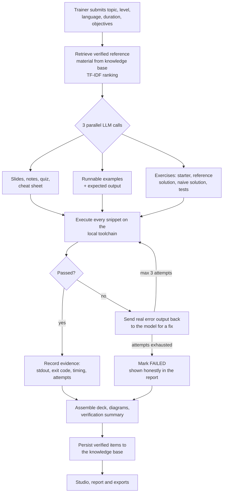
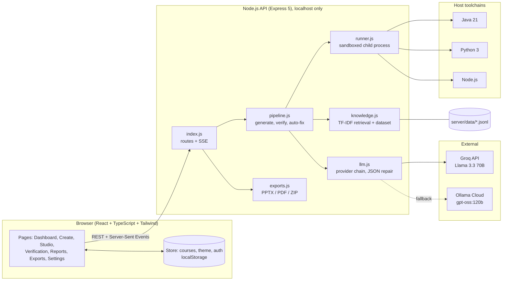
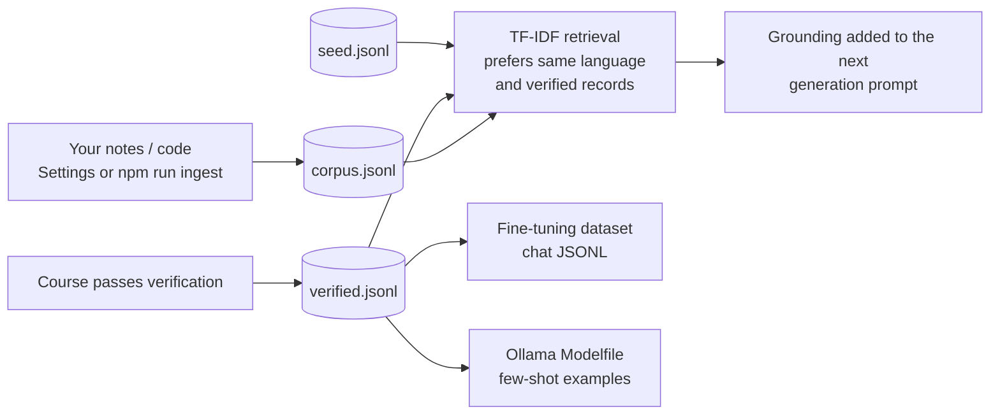

<div align="center">

# LearnifyAI · Verified Course Material Studio

**Generate complete, classroom-ready programming course material, and prove that every line of code in it actually runs.**


</div>

---

## Table of contents

1. [Overview](#1-overview)
2. [Key features](#2-key-features)
3. [How it works](#3-how-it-works)
4. [Architecture](#4-architecture)
5. [Quick start](#5-quick-start)
6. [Configuration](#6-configuration)
7. [API reference](#7-api-reference)
8. [The verification model](#8-the-verification-model)
9. [Verified knowledge base ("learning")](#9-verified-knowledge-base-learning)
10. [Exports](#10-exports)
11. [Security model](#11-security-model)
12. [Status against the problem statement](#12-status-against-the-problem-statement)
13. [Known limitations](#13-known-limitations)
14. [Roadmap](#14-roadmap)
15. [Project structure](#15-project-structure)
16. [Scripts](#16-scripts)
17. [Troubleshooting](#17-troubleshooting)
18. [Contributing](#18-contributing)
19. [License](#19-license)

---

## 1. Overview

### The problem

Trainers spend their evenings preparing slides, notes, code examples and assignments, and that material goes stale as soon as a framework ships a new release. General-purpose AI tools can draft a whole lesson in minutes, but the code they produce often does not compile, uses deprecated APIs, or silently gives wrong results. In a classroom, a broken example is worse than none: it wastes a session and erodes students' trust in the trainer.

### The approach

LearnifyAI treats the LLM as an **untrusted author** and the language runtime as the **source of truth**.

1. The model drafts the material (slides, speaker notes, runnable examples, exercises with tests, quiz, cheat sheet).
2. Every code snippet is **executed on a real toolchain**. Examples must print exactly the output the slide promises. Every exercise ships with a reference solution that must pass all of its tests, plus a deliberately naive solution that must **fail** at least one test, which proves the tests actually test something.
3. Failures are fed back to the model together with the real compiler or test output, for up to three repair attempts.
4. The trainer sees a verification report that shows exactly what was run, how many attempts it took, and the result. Nothing is marked "verified" because the model said so. The status always comes from an actual process exit code and captured output.

---

## 2. Key features

| Area | What you get |
|---|---|
| **Course generation** | Topic, level, language, session length and learning objectives go in. Out come a slide deck with speaker notes and generated diagrams, 3–4 runnable examples, 2–3 exercises with automated tests, a 6-question quiz with explanations, and a one-page cheat sheet. |
| **Real code verification** | Java 21, Python, Node.js and TypeScript snippets are executed locally. Pass/fail is derived from exit codes and stdout, not from model claims. |
| **Self-repair loop** | A failing snippet is sent back to the model with the real error output. Up to 3 attempts, and every attempt is recorded. |
| **Test-quality check** | Each exercise has a reference solution (must pass every test) and a naive solution (must fail at least one). Exercises where the naive solution passes everything are rejected and repaired. |
| **Studio editor** | Edit slides and notes, regenerate a **single slide** without touching the rest (its code is re-verified), run examples and exercise tests, load the reference or naive solution, ask the AI to fix a failing example. |
| **Verification dashboard** | Run all or selected snippets, per-snippet attempts, logs and timings, plus a downloadable PDF report. |
| **Exports** | Real PPTX (with speaker notes), slides PDF, trainer notes PDF, quiz PDF, cheat-sheet PDF, verification report PDF, code ZIP, exercises ZIP, and a full package ZIP. |
| **Assistant** | A chat panel grounded in your verified course material. |
| **Verified knowledge base** | Courses that pass verification are stored and retrieved as grounding for future generations. Your own notes and code can be ingested too. A fine-tuning dataset (chat-format JSONL) and an Ollama Modelfile can be exported. |
| **Live progress** | Server-sent events stream real progress while the model writes and the toolchain runs. |
| **Provider fallback** | Groq (Llama 3.3 70B) first, Ollama Cloud (gpt-oss:120b) as automatic fallback, with retry on 429/5xx. |
| **UX** | Light/dark theme, command palette, responsive layout, offline "Sample mode" with a built-in demo course when the API is not running. |

---

## 3. How it works



### Verification rules

| Artefact | It counts as **passed** only if |
|---|---|
| **Example** | The process exits with code 0 within the time limit **and** its normalised stdout equals the expected output stated on the slide. |
| **Exercise: reference solution** | Exit code 0, at least 3 `PASS:` lines, and no `FAIL:` lines. |
| **Exercise: naive solution** | It runs its tests, prints at least one `FAIL:` line, and does not crash. A naive solution that passes everything means the tests are too weak, so it is rejected. |
| **Regenerated slide** | If the slide contains code and the code changed, the new code is re-run before the slide is accepted. |

### Sizing rules

| Session length | Slides | Examples | Exercises |
|---|---|---|---|
| 30 min | 8 | 3 | 2 |
| 60 min | 10 | 3 | 2 |
| 90 min | 13 | 4 | 3 |
| 120 min | 14 | 4 | 3 |

Slides are limited to 5 bullets of at most 12 words each. Code on a slide is limited to 18 lines, and a code slide that would exceed this automatically falls back to a bullet layout so that nothing overflows. Diagrams are generated by the model as a node/edge list and laid out deterministically by the server, so no image generation is involved.

---

## 4. Architecture



### Technology

| Layer | Choice |
|---|---|
| Front end | React 18, TypeScript 5.9, Vite 5, Tailwind CSS 3, Radix UI primitives, React Router 6, Recharts, cmdk, Sonner |
| API | Node.js (ES modules), Express 5, Server-Sent Events for streaming progress |
| LLM access | Plain `fetch` to Groq (OpenAI-compatible) and Ollama Cloud, with JSON mode, one automatic JSON-repair round-trip and one retry on 429/5xx |
| Execution | `child_process.spawn` with a temp directory per run, a stripped environment, a 10 s timeout and 20 KB output cap |
| Documents | `pptxgenjs` (PPTX), `pdfkit` (PDF), `archiver` (ZIP) |
| Knowledge store | Append-only JSONL files with in-process TF-IDF ranking (no external vector DB) |

### Design decisions

- **Provider-agnostic LLM layer.** The provider chain is configured through `LLM_PROVIDER`. Adding a provider means adding one function to `llm.js`.
- **The model never decides success.** Status fields are written only by the runner based on real execution.
- **Secrets stay on the server.** API keys are read by the Node process only and are never part of the browser bundle.
- **Graceful degradation.** Languages without a runner (for example React, SQL or Docker courses) are still generated but are clearly labelled **unverified** instead of being silently trusted.
- **No heavy dependencies for retrieval.** TF-IDF over a few hundred records is fast, transparent and easy to audit.

---

## 5. Quick start

### Prerequisites

| Requirement | Version | Needed for |
|---|---|---|
| Node.js | **22 or newer** (20 works, except TypeScript snippet verification) | Everything |
| JDK | **21** (`java` and `javac` on `PATH`) | Verifying Java courses |
| Python | **3.10+** (3.12 recommended) | Verifying Python courses |
| LLM API key | Groq and/or Ollama Cloud | Course generation |

Java, Python and Node are only needed for the languages you want verified. Without a toolchain the app still works, but the affected code is marked *unverified*. Supported on Windows, macOS and Linux.

### Install and run

```bash
git clone https://github.com/<your-org>/learnify-ai.git
cd learnify-ai/learnify          # the folder that contains package.json

npm install

cp server/.env.example server/.env      # Windows PowerShell: copy server\.env.example server\.env
# edit server/.env and add at least one API key (see Configuration)

npm run dev:all                  # API on :8787 + web app on :5173
```

Open **http://localhost:5173**. The login screen is a front-end demo: enter any email and a password of 6 or more characters.

On start-up the API prints which providers and toolchains it found:

```
LearnifyAI API on http://127.0.0.1:8787
  providers: groq, ollama
  runners:   java:yes python:yes node:yes
  knowledge: {"total":35,"seed":35,"corpus":0,"verified":0,"byKind":{...}}
```

### First run walkthrough

1. Go to **Create Course**, enter a topic such as `Java Streams`, choose **Java 21**, **Beginner**, **60 minutes**, then generate.
2. Watch the live log: model calls, each snippet being executed, any failures and auto-fix attempts.
3. Open the course in the **Studio**, edit a slide, or regenerate one slide.
4. Open **Verification** and **Reports** to see the evidence, then download from **Exports**.

### Production build

```bash
npm run build      # type-check + production bundle
npm start          # build, then API (:8787) + preview server (:4173)
```

---

## 6. Configuration

All server settings live in `server/.env` (git-ignored). Copy `server/.env.example` to start.

| Variable | Default | Description |
|---|---|---|
| `GROQ_API_KEY` | none | Groq API key. Enables the Groq provider. |
| `GROQ_MODEL` | `llama-3.3-70b-versatile` | Groq model name. |
| `GROQ_BASE_URL` | `https://api.groq.com/openai/v1` | Override for any OpenAI-compatible endpoint. |
| `OLLAMA_API_KEY` | none | Ollama Cloud API key. Enables the Ollama provider. |
| `OLLAMA_HOST` | `https://ollama.com` | Ollama endpoint. |
| `OLLAMA_MODEL` | `gpt-oss:120b` | Ollama model name. |
| `LLM_PROVIDER` | `groq,ollama` | Provider order. The first available provider is used and the next is the fallback. |
| `PORT` | `8787` | API port (always bound to `127.0.0.1`). |
| `ALLOW_REMOTE` | unset | Set to `1` to accept non-local requests. **Only do this inside an isolated container.** |

At least one of `GROQ_API_KEY` or `OLLAMA_API_KEY` is required. **Never commit `server/.env`.**

---

## 7. API reference

All routes are served by the Node API on `http://127.0.0.1:8787`.

| Method | Route | Purpose |
|---|---|---|
| `GET` | `/api/health` | Providers, detected toolchains and knowledge-base stats. Add `?probe=1` for a live LLM round-trip. |
| `POST` | `/api/generate` | Generate a course. Responds as **Server-Sent Events**: `progress` (step, percent, log line), `done` (the full course), `error`. |
| `POST` | `/api/run` | Execute one snippet. Body: `{ language, code }`. Returns `{ ok, exitCode, stdout, stderr, ms, timedOut }`. |
| `POST` | `/api/fix` | Ask the model to repair a failing snippet using its real output. |
| `POST` | `/api/slide/regenerate` | Rewrite one slide from an instruction. Code is re-verified if it changed. |
| `POST` | `/api/chat` | Assistant chat grounded in retrieved verified material. |
| `POST` | `/api/export/:format` | Build a file. `format` is one of `pptx`, `pdf`, `notes`, `quiz`, `cheat`, `report`, `code`, `exercises`, `package`. |
| `GET` | `/api/dataset` | Download the fine-tuning set. Query: `format=chat\|raw`, `verified=1`. |
| `GET` | `/api/knowledge/stats` | Knowledge-base counts by source and kind. |
| `POST` | `/api/ingest` | Add pasted material to the knowledge base. |

**Example: generate a course**

```bash
curl -N -X POST http://127.0.0.1:8787/api/generate \
  -H "Content-Type: application/json" \
  -d '{
        "topic": "Java Streams",
        "language": "Java",
        "version": "21",
        "level": "Beginner",
        "durationMin": 60,
        "objectives": ["Use map/filter/reduce", "Collect results"]
      }'
```

**Example: run a snippet**

```bash
curl -X POST http://127.0.0.1:8787/api/run \
  -H "Content-Type: application/json" \
  -d '{"language":"Python","code":"print(sum(range(5)))"}'
# {"ok":true,"exitCode":0,"stdout":"10","stderr":"","ms":42,"timedOut":false}
```

---

## 8. The verification model

### Supported runtimes

| Language label in the UI | Runtime | Execution |
|---|---|---|
| Java | JDK 21 | `java Main.java` (source-file mode, single file, no packages, no external libraries) |
| Python | Python 3 | `python main.py` (standard library only) |
| Node.js / JavaScript | Node 20+ | `node main.mjs` (ES modules, built-ins only, `node:assert` for checks) |
| TypeScript | Node 22.6+ | `node --experimental-strip-types main.ts` (erasable syntax only) |
| Anything else | n/a | Generated, labelled **unverified** |

### Self-checking test contract

To keep tests framework-free and runnable anywhere, exercises are single self-checking programs that print one line per test and signal the result through the exit code:

```
PASS: handles empty list
FAIL: sorts descending - expected [3,2,1] but got [1,2,3]
```

### What a "verified" badge does and does not mean

**It means:**
- The code compiled and ran on the toolchain installed on the machine running the server.
- Examples produced exactly the stated output.
- Reference solutions passed all of their tests, and naive solutions were caught by at least one test.

**It does not mean:**
- The code is correct for versions other than the installed one (see [limitations](#13-known-limitations)).
- The tests are exhaustive. They are LLM-written and checked for *discriminating power*, not coverage.
- The pedagogy is sound. A trainer should still review the material. LearnifyAI removes the "does it even run?" risk, not the need for judgement.

---

## 9. Verified knowledge base ("learning")

The app improves with use through **retrieval**, not weight training.



- **Only verified material is trusted.** Passing examples and exercises are saved with `verified: true`, and ranking favours verified records.
- **Bring your own data.** Paste material in *Settings → AI & Training*, or run `npm run ingest -- ./my-notes Java` (`.md .txt .java .py .js .ts .json .jsonl`).
- **Real fine-tuning is possible but external.** Groq and Ollama Cloud serve models; they do not train weights from this app. Export `GET /api/dataset?format=chat` and use it with Unsloth, Axolotl or a provider fine-tuning API. `npm run modelfile` writes `server/data/Modelfile` for `ollama create`.

---

## 10. Exports

| Format | File | Notes |
|---|---|---|
| `pptx` | `<course>.pptx` | Title, bullet, code, diagram, two-column and summary layouts, speaker notes included, brand colour and logo text from the Brand Kit. |
| `pdf` | `<course>-slides.pdf` | Landscape slide handout. |
| `notes` | `<course>-trainer-notes.pdf` | Per-slide speaker notes. |
| `quiz` | `<course>-quiz.pdf` | Questions, options, answers and explanations. |
| `cheat` | `<course>-cheat-sheet.pdf` | One-page reference. |
| `report` | `<course>-verification-report.pdf` | Per-snippet status, attempts, timings and logs. |
| `code` | `<course>-code.zip` | All example sources. |
| `exercises` | `<course>-exercises.zip` | Starter, reference and naive versions with tests. |
| `package` | `<course>-full-package.zip` | Everything above in one archive. |

---

## 11. Security model

> **Running LLM-generated code is inherently risky. Read this section before deploying anywhere other than your own machine.**

### What is in place

- API keys are loaded server-side only and never reach the browser bundle.
- The API binds to `127.0.0.1` and **rejects non-local requests** unless `ALLOW_REMOTE=1`.
- Each run uses a fresh temp directory (deleted afterwards), a **10-second timeout** (`SIGKILL` on expiry) and a **20 KB output cap**.
- The child process receives a **stripped environment**: `PATH`, `HOME` (the temp dir) and `LANG` only, so no API keys or user secrets are inherited.
- Prompts constrain generated programs to be deterministic, input-free and network-free.
- Request bodies are limited to 4 MB.

### What is **not** in place

- **No OS-level sandbox.** Code runs as a normal child process under the server's user account. It can read files that account can read, and it is not network-isolated by the app itself.
- No CPU/memory limits (only wall-clock time).
- The demo login is client-side only. There is no server-side authentication or multi-tenancy.

### Recommended hardening for anything beyond local use

1. Run the API in a **container** with `--network none`, a read-only root filesystem, a non-root user, and CPU/memory limits (for example `--cpus 1 --memory 512m --pids-limit 128`), and mount nothing sensitive.
2. Or replace `runner.js` with a per-run ephemeral container or microVM (Docker, gVisor, Firecracker).
3. Add real authentication before enabling `ALLOW_REMOTE`.

---

## 12. Status against the problem statement

This project targets **"PS5: Verified Course Material Studio"**. The table is deliberately candid.

| Requirement | Status | Notes |
|---|---|---|
| Slide deck, trainer notes, runnable examples, exercises with tests, quiz with explanations, one-page cheat sheet | ✅ Implemented | Generated from topic, level and session length. |
| Export to PowerPoint and PDF | ✅ Implemented | Real files. Branding is limited to a primary colour and logo text. |
| Slides laid out to fit; code readable; diagrams generated | 🟡 Partial | Bullet/line limits, 18-line code cap and layout fallbacks are enforced. Actual rendered overflow is not measured. Diagrams are generated and auto-laid-out. |
| Extract and execute every code snippet | ✅ Implemented | Java, Python, Node.js, TypeScript. |
| Run against **pinned** versions (for example Java 21, Spring Boot 3) | 🟡 Partial | Runs on whatever toolchain is installed. Java 21 is the target and is required. Framework projects (Spring Boot, React) are not executed. |
| Reference solution passes; deliberately naive solution fails | ✅ Implemented | Enforced by the pipeline, and weak tests are rejected. |
| Regenerate until it passes; verification report | ✅ Implemented | 3 attempts, full attempt history, PDF report. |
| Regenerate a single slide without disturbing the rest | ✅ Implemented | Code in the slide is re-verified. |
| Update a deck from an older framework version to a newer one, re-verifying changed examples | 🔴 Not yet | The *Upgrades* page is a UI prototype with sample data. |
| Optional: learn trainer style from past decks | 🟡 Partial | Retrieval-based grounding and ingestion of your own material. No deck-style extraction yet. |
| Optional: class recordings to structured notes | 🔴 Not yet | |
| Optional: map material against a syllabus and show gaps | 🔴 Not yet | The *Coverage* page is a UI prototype with sample data. |

---

## 13. Known limitations

- **Pinned versions are labels, not isolation.** Verification uses the locally installed JDK, Python and Node. Results can differ on other versions.
- **Framework-level code is unverified.** Spring Boot, React, SQL, Docker and similar topics are generated but not executed.
- **Weak process isolation** (see [Security model](#11-security-model)).
- **No server-side persistence.** Courses are stored in the browser's `localStorage`. Clearing site data removes them. The knowledge base is the only server-side store (JSONL files).
- **Demo authentication.** The login screen does not protect anything.
- **Prototype pages.** *Upgrades*, *Coverage*, *Team*, *Brand Kit* settings and parts of *Resources* use sample data (`src/lib/mock-data.ts`) and are not backed by the API.
- **No automated test suite yet.** The verification pipeline is exercised through the product itself. Unit and integration tests are on the roadmap.
- **LLM variability.** Output quality depends on the model. A course can finish with some snippets marked *failed* after three attempts, and the report says so openly.
- **Language-specific constraints.** Java examples must be a single file (`public class Main`), with no packages or external libraries.

---

## 14. Roadmap

**Near term**
- [ ] Container-based execution (`--network none`, non-root, CPU/memory limits) replacing the raw child process
- [ ] Pinned toolchain images per course (JDK 21, Node 22, Python 3.12) selected from the course's version field
- [ ] Persistent storage (SQLite) with course versions and per-version verification history
- [ ] Automated tests for the runner, parsers and pipeline (with a stubbed LLM)

**Medium term**
- [ ] **Deck upgrade flow:** scan an existing deck, rewrite affected snippets for a target framework version, re-verify only the changed examples, and show a diff
- [ ] Maven/Gradle and npm project runners for Spring Boot and React examples
- [ ] Real syllabus coverage mapping and gap report
- [ ] Rendered-slide overflow checks and automatic slide splitting
- [ ] Brand template import (`.potx`, fonts, logo)

**Longer term**
- [ ] Trainer style learning from past decks
- [ ] Transcription of class recordings into structured notes
- [ ] Multi-user accounts, sharing and review workflows

---

## 15. Project structure

```
learnify/
├── server/                     Node.js API
│   ├── index.js                Routes, SSE streaming, localhost guard
│   ├── pipeline.js             Generate → verify → auto-fix → assemble; slide regeneration; assistant
│   ├── llm.js                  Provider chain (Groq → Ollama), JSON mode, JSON repair, retries
│   ├── runner.js               Cross-platform execution of Java / Python / Node / TypeScript
│   ├── knowledge.js            JSONL store, TF-IDF retrieval, dataset export
│   ├── exports.js              PPTX / PDF / ZIP builders
│   ├── env.js                  Minimal .env loader (no dependency)
│   ├── data/seed.jsonl         Seed knowledge (35 records)
│   └── .env.example            Configuration template
├── scripts/
│   ├── seed-from-mock.mjs      Rebuild the seed from the sample course
│   ├── ingest.mjs              Ingest files or folders into the knowledge base
│   └── build-modelfile.mjs     Generate an Ollama Modelfile from verified examples
├── src/                        React + TypeScript front end
│   ├── pages/                  Landing, auth, Dashboard, CreateCourse, Studio, Verification,
│   │                           Reports, Exports, Settings (AI & Training), and others
│   ├── components/             ui/ (Radix-based primitives), layout/, shared/
│   └── lib/                    api.ts (client), store.tsx (state), content.ts, mock-data.ts
├── public/                     Static assets
└── package.json
```

**Front-end routes:** `/` landing, `/login`, `/register`, `/forgot-password`, then `/dashboard`, `/courses`, `/courses/new`, `/studio/:id`, `/verification`, `/reports`, `/upgrades`, `/coverage`, `/resources`, `/brand-kit`, `/exports`, `/settings`, `/team`, `/help`.

---

## 16. Scripts

| Command | What it does |
|---|---|
| `npm run dev:all` | API (:8787) and Vite dev server (:5173) together with hot reload |
| `npm run server` | API only |
| `npm run dev` | Front end only |
| `npm run build` | Type-check (`tsc -b`) and production build |
| `npm start` | Build, then API + preview server on :4173 |
| `npm run seed` | Rebuild `server/data/seed.jsonl` from the sample course |
| `npm run ingest -- <path> [language]` | Add your own files or folders to the knowledge base |
| `npm run modelfile [base-model]` | Write `server/data/Modelfile` for `ollama create` |

---

## 17. Troubleshooting

| Symptom | Likely cause and fix |
|---|---|
| Browser shows `ERR_CONNECTION_REFUSED` | The API crashed on start-up and `concurrently` stopped both processes. Scroll up in the terminal for the first error. |
| `npm` is not recognised | Install Node.js and restart the terminal or editor. |
| PowerShell blocks `npm` scripts | Run `Set-ExecutionPolicy -Scope CurrentUser RemoteSigned`, or use Command Prompt. |
| `All LLM providers failed` | Invalid or exhausted API key. Check `server/.env` and try `GET /api/health?probe=1`. |
| Everything is marked *unverified* | The toolchain is not on `PATH`. Check the `runners:` line printed at start-up and install JDK 21 / Python / Node. |
| `python` opens the Microsoft Store (Windows) | Install Python from python.org, or disable the *App execution aliases* for Python. |
| TypeScript snippets fail to run | Needs Node 22.6+ for `--experimental-strip-types`. |
| "Sample mode" banner | The front end cannot reach the API on :8787. Start it with `npm run dev:all`. |
| `Local access only` (HTTP 403) | You are calling the API from a non-local address. See [Security model](#11-security-model) before setting `ALLOW_REMOTE=1`. |
| Port already in use | Another process is using 5173 or 8787. Stop it or change `PORT`. |

---

## 18. Contributing

Issues and pull requests are welcome.

1. Fork the repository and create a feature branch.
2. Run `npm run build` and make sure it passes the type-check.
3. Keep server code dependency-light and keep secrets out of the browser bundle.
4. For changes to the runner or pipeline, describe how you verified the behaviour, since automated tests are still being added.
5. Open a pull request with a clear description and screenshots for UI changes.

---

## 19. License

MIT © 2026 LearnifyAI contributors. See `LICENSE`.

---

<div align="center">

**LearnifyAI** treats the model as an author and the compiler as the editor.

</div>
